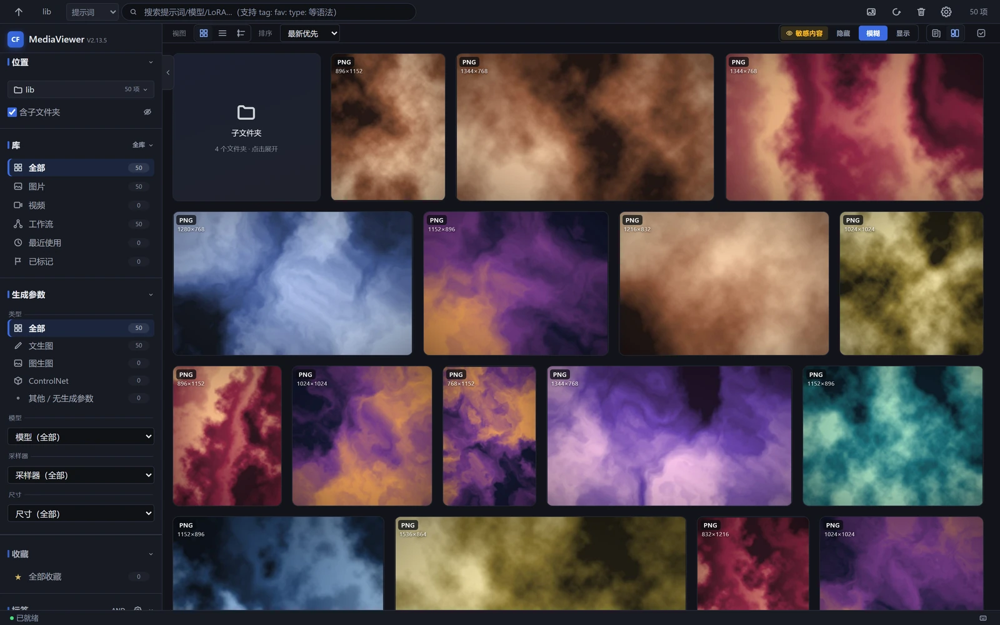
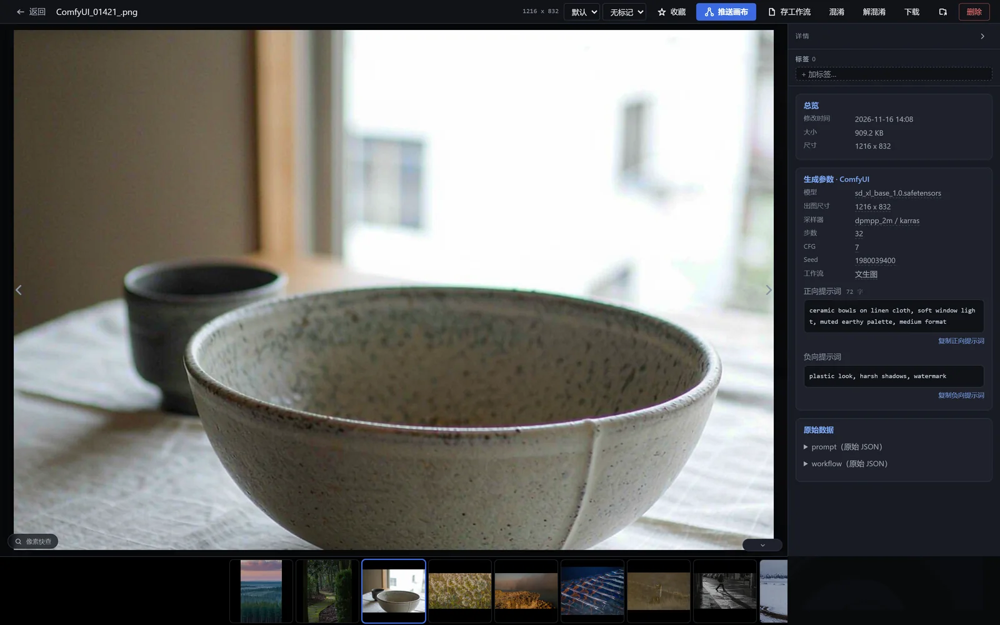
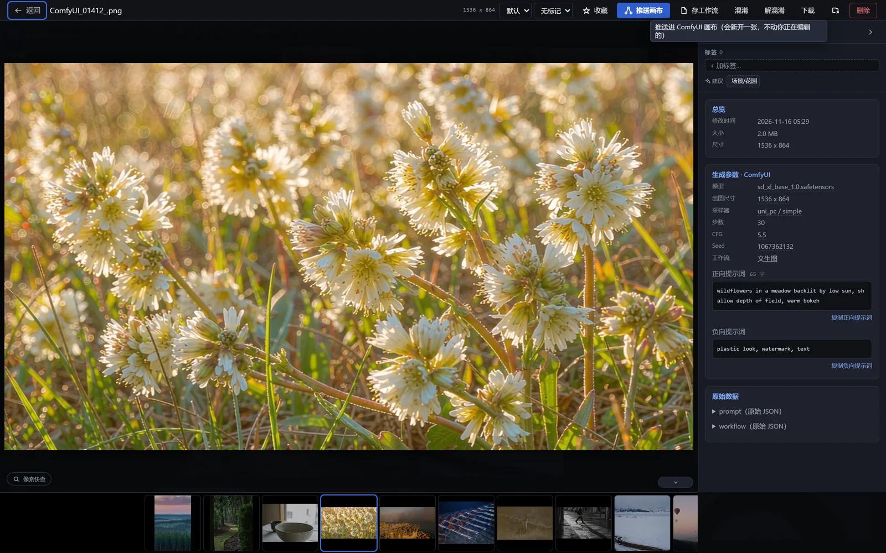
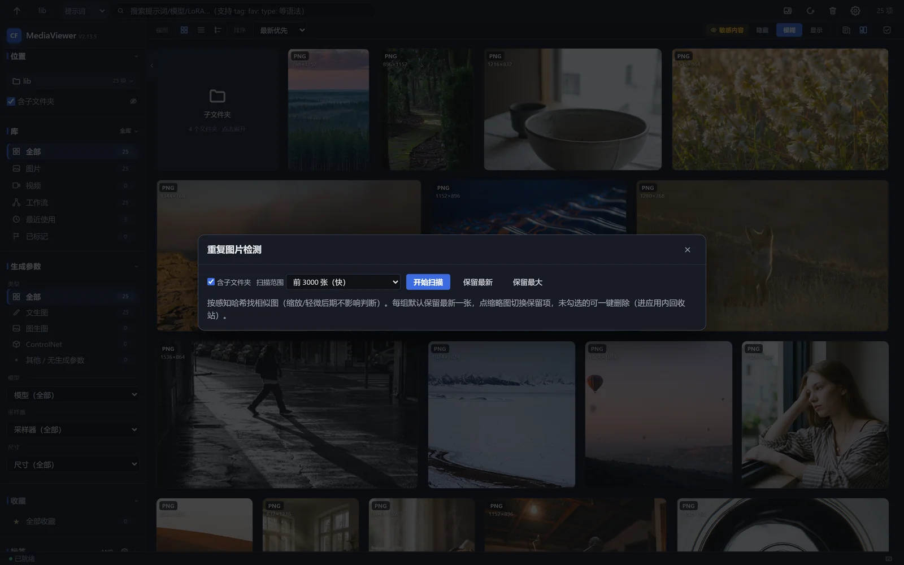
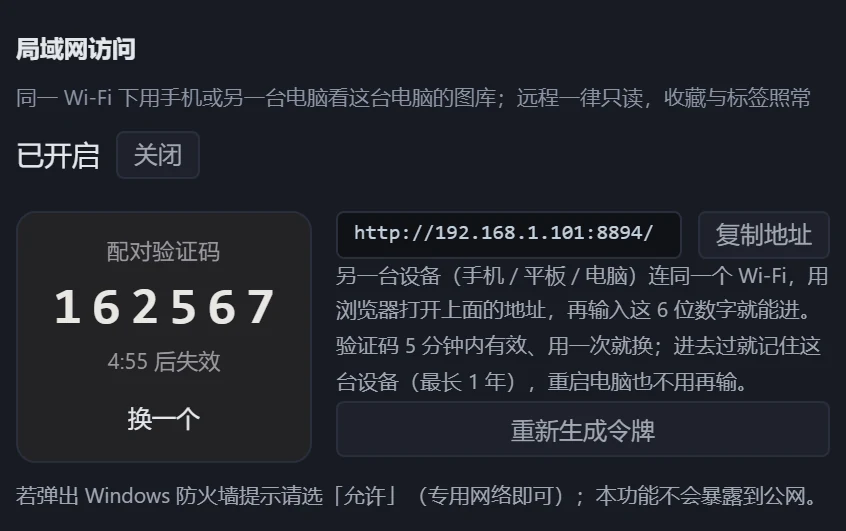
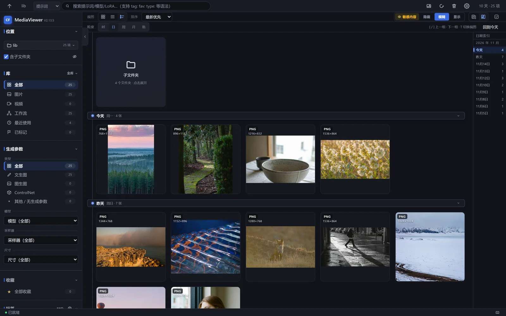
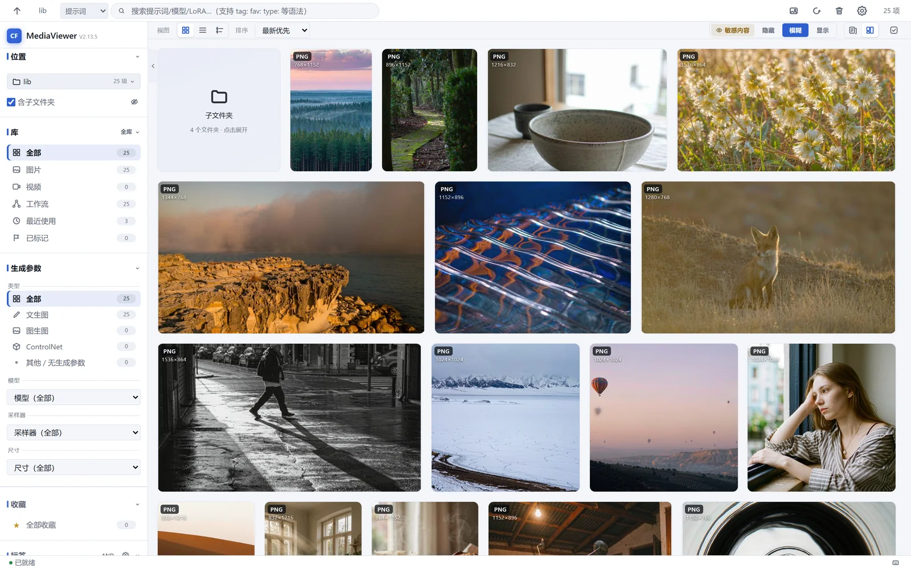

<p align="center">
  
</p>

<h1 align="center">ComfyMediaViewer</h1>

<p align="center">
  <b>出图越来越多，想找的那张却越来越难找。</b><br>
  这个工具把你的 ComfyUI 出图目录变成一个能按提示词、模型、日期检索的图库。
</p>

<p align="center">
  <a href="https://github.com/Hartmann1995/ComfyMediaViewer/releases/latest"></a>
  <a href="LICENSE"></a>
  
</p>

<p align="center">
  <a href="https://github.com/Hartmann1995/ComfyMediaViewer/releases/latest"><b>下载 Windows 版</b></a> ·
  <a href="doc/使用说明.md">使用说明</a> ·
  <a href="doc/CHANGELOG.md">更新日志</a> ·
  <a href="https://github.com/Hartmann1995/ComfyMediaViewer/issues">问题反馈</a>
</p>

---

## 它帮你解决什么

ComfyUI 跑一段时间，`output` 里就是几千上万张 PNG。文件名是时间戳，参数埋在图片里，
想知道「上周那批图用的什么模型」只能一张张点开看。

ComfyMediaViewer 给这堆图加一层检索：

| 你想做的事 | 在这里怎么做 |
|---|---|
| 看清这张图是用什么模型、什么 LoRA、什么参数出的 | 点开即看，正负提示词、采样链路都在 |
| 找出上周所有用 `dpmpp_2m` 出的风景图 | 输入 `sampler:dpmpp_2m`，再点两下左栏条件 |
| 知道这个月出了多少张、常用哪些模型 | 出图统计，日历热力图 + Top 10 |
| 同一张图存了三份，清掉多余的 | 查重按组比对，保留一张，其余移到回收站 |
| 想把图发出去，又不想带上提示词 | 下载时自动剥掉元数据，画面不变 |
| 手滑删错了 | 应用内回收站，默认保留 30 天 |

**你的图不会被改动。** 目录只读，索引和缩略图缓存都放在本机的
`%LOCALAPPDATA%\ComfyMediaViewer\`，不联网、不上传。

## 主要功能

### 每张图的配方，点开就知道

<p align="center"></p>

模型、尺寸、采样器与调度器、步数、CFG、Seed、实际启用的 LoRA、正向与负向提示词，
每一项都能一键复制。高清修复这类多段采样会展开成链路表，每段各自的参数都留着，
不会只显示第一段。

### 把这张图送回 ComfyUI 的画布

<p align="center"></p>

大图页点「推送画布」，这张图的工作流会作为一个新画布送进 ComfyUI——你手上正在编辑的
那张不受影响，也不用先导出 json 再拖进窗口。ComfyUI 开着就送进已经打开的页面，没开的话
会另起一个窗口；两种情况都只是把节点摆好，不会自动开始生成，确认参数后自己点 Queue。
图里没内嵌工作流的，可以用模板套上这张图的参数再发。

### 按条件找图，不用一张张翻

<p align="center"></p>

在搜索框输入 `sampler:dpmpp_2m`、`model:juggernaut`、`after:2026-11-01` 这类条件，
它会变成一个可以单独删掉的小标签，右边实时显示命中了多少张。

可用的条件：`tag:` `model:` `sampler:` `size:` `fav:` `type:` `after:` `before:`
`name:` `wf:`。左栏的「位置 / 库 / 生成参数」也能直接点着筛，和搜索叠加生效。

### 看清这段时间都出了什么

<p align="center"></p>

每日热力图（一列一周，颜色越深当天出图越多）+ 模型 / 采样器 / 尺寸 Top 10。
点任一行就直接按这个条件筛图，从「看看」一步走到「找出来」。

### 清理重复，发图不留配方

<p align="center"></p>

查重按画面内容分组，每组默认保留最新的一张，也可以自己换。扫描范围可选
「前 3000 张（快）」或「全部」，结果会写明扫了多少张。

下载图片或视频时，可以选择抹掉里面的提示词与工作流——像素和时长不变，
适合直接发给别人。

### 手机、平板也能翻同一个图库

<p align="center"></p>

设置 → 数据 → 局域网访问，打开后给一个 6 位配对码和一个内网地址。同一 Wi-Fi 下的手机
或另一台电脑，浏览器打开地址、输一次验证码就能翻图，收藏和标签照常能用；删除、重命名
这类写操作仍然只在电脑上做。验证码 5 分钟内有效、用一次就换，连过的设备会记住，
重启电脑也不用再输。

### 网格、列表、时间轴，随时换

<p align="center"></p>

网格适合看图，列表适合对着文件名和参数找，时间轴按批次 / 时 / 日 / 周 / 月分组，
右侧日期索引点一下直接跳到那天。按 `T` 在时间轴和网格之间来回切。

### 深色、亮色都行

<p align="center"></p>

深色是默认，适合长时间看图；设置里可以切成亮色，或者跟随系统。

## 还支持

- **整理**：星标收藏、自定义分类、8 组标签色、工作标记（待处理 / 待发布 / 待比较 / 待删除）、
  Shift 连选批量操作
- **媒体格式**：PNG / JPG / WebP / GIF / BMP；视频支持 MP4 / WebM / MOV / M4V / MKV / AVI，
  视频里的生成参数同样能读能搜
- **像素快查**：按住 `Ctrl` 悬停，放大看细节，中键可以把放大镜钉住

## 下载与安装

1. 打开 [Releases](https://github.com/Hartmann1995/ComfyMediaViewer/releases/latest)，
   下载 `ComfyMediaViewer-Desktop-V<版本>.exe`
2. 双击运行，不用安装
3. 第一次打开时，它会自己找 `ComfyUI/output`；如果找的不是你想看的目录，
   在左栏「位置」里换成正确的那个

不需要装 Python，也不需要配环境。

第一次打开会先把目录扫一遍，扫完就能开始看图；提示词索引在后台继续建，期间搜索框
显示「索引中」，建好之后就能搜到全部历史图片。之后再打开只处理新增的文件。

想从源码跑的话：

```bat
pip install -r requirements.txt
start_dev.bat
```

## 快捷键

按 `?` 随时唤出速查面板。

| 场景 | 按键 | 作用 |
|---|---|---|
| 全局 | `/` | 聚焦搜索框 |
| 全局 | `R` | 重新扫描当前目录 |
| 视图 | `T` | 时间轴 ⇄ 网格 |
| 视图 | `N` | 内容显示：隐藏 ⇄ 模糊 ⇄ 显示 |
| 大图 | `←` `→` | 上一张 / 下一张 |
| 大图 | `P` | 展开 / 收起详情面板 |
| 大图 | `F` | 底部预览栏 |
| 大图 | `Del` | 删除当前图（进回收站） |
| 大图 | 按住 `Ctrl` | 像素快查 |
| 视频 | `空格` / `,` `.` | 播放暂停 / 逐帧 |
| 视频 | `L` / `M` | 循环 / 静音 |
| 时间轴 | `[` `]` | 上一组 / 下一组 |
| 通用 | `Esc` | 逐层关闭：大图 → 对比 → 批量 → 弹窗 |

## 常见问题

**会改我的图片吗？**
不会。目录只读，不移动、不改写原文件。删除会移到回收站，可以还原。

**要联网吗？**
日常使用不联网，没有遥测。唯一的对外请求是查 LoRA 出处时，把 LoRA 名字或哈希
发给 Civitai，用于找到对应的模型页，可以在设置里关掉。

**支持哪些格式？**
图片 PNG / JPG / WebP / GIF / BMP；视频 MP4 / WebM / MOV / M4V / MKV / AVI。

**图库里有很多张，会不会很卡？**
缩略图按需生成并缓存，第二次打开就快了。超大库（万张以上）首次建索引需要等一会儿。

**「内容检测」是什么？**
一个可选的本地图片分类功能，开机即用的离线小模型，用来初筛不方便直接显示的图。
只做粗略判断，不保证准确；模型缺失时会自动降级，不影响其它功能。

**能装在别的系统上吗？**
目前只提供 Windows 10 / 11 的桌面版。后端本身不依赖平台，但目录探测和托盘行为
是按 Windows 做的。

---

## 反馈

遇到问题请开 [Issue](https://github.com/Hartmann1995/ComfyMediaViewer/issues)，
附上版本号（设置 → 关于）、系统版本，以及怎么复现。界面问题的截图最有用。

<p align="center"></p>

想改代码也欢迎：后端是一个 `server.py`，前端是原生 JS/CSS，没有构建步骤，
改完刷新页面就能看到效果。

本项目与 ComfyUI 官方无隶属关系，是独立的第三方工具。

## 许可

代码以 [MIT](LICENSE) 发布。随包的内容检测模型来源与许可见
[`models/nsfw/NOTICE.md`](models/nsfw/NOTICE.md)。
