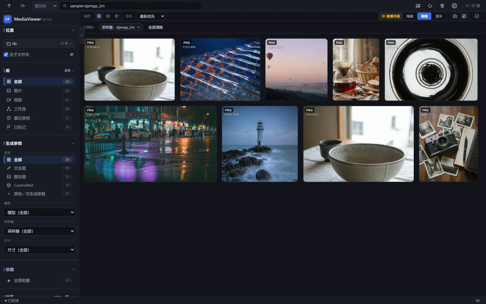
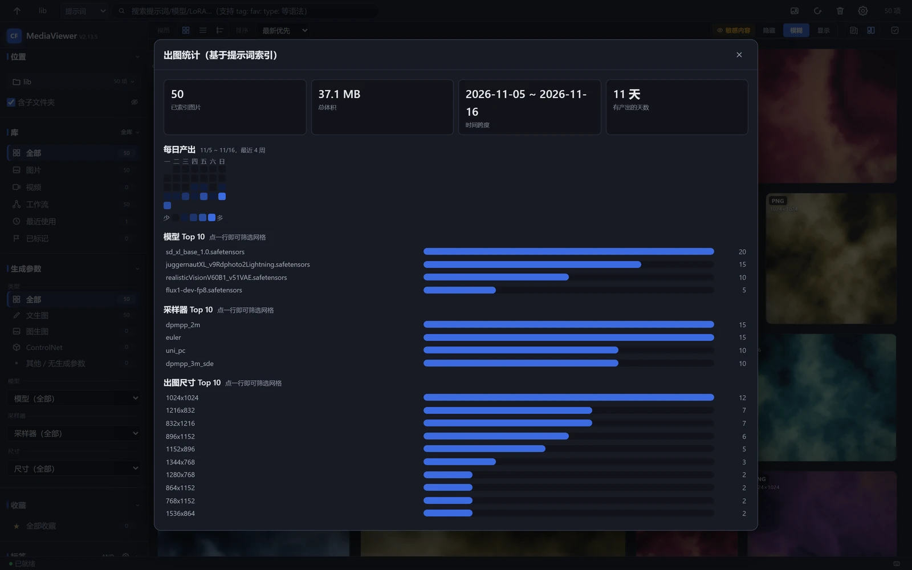
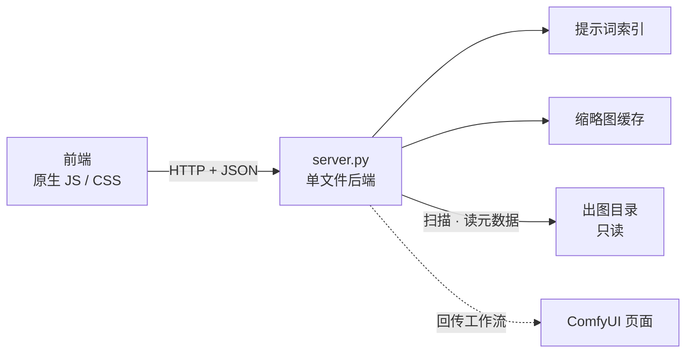
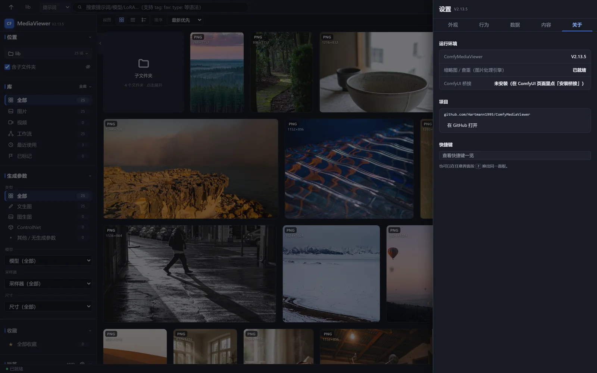

<p align="center">
  
</p>

<h1 align="center">ComfyMediaViewer</h1>

<p align="center">
  <b>给 ComfyUI 出图目录配一个「能按提示词找图」的本地浏览器</b><br>
  扫一遍 <code>ComfyUI/output</code>，网格看片、点开看配方、按条件筛图、抹掉元数据再分享。
</p>

<p align="center">
  <a href="https://github.com/Hartmann1995/ComfyMediaViewer/releases/latest"></a>
  <a href="https://github.com/Hartmann1995/ComfyMediaViewer/actions/workflows/ci.yml"></a>
  <a href="LICENSE"></a>
  
  
</p>

<p align="center">
  <a href="https://github.com/Hartmann1995/ComfyMediaViewer/releases/latest"><b>下载桌面版</b></a> ·
  <a href="doc/使用说明.md">使用说明</a> ·
  <a href="doc/CHANGELOG.md">变更日志</a> ·
  <a href="https://github.com/Hartmann1995/ComfyMediaViewer/issues">问题反馈</a>
</p>

---

## 它解决什么问题

ComfyUI 的出图目录很快就会变成几千上万张 PNG：文件名没有语义，参数埋在 PNG 的
`tEXt` 块里，想找「上周那批用 dpmm_2m、seed 打头的图」只能一张张点开看。

ComfyMediaViewer 把这堆文件当成一个有索引的库：

| 你的问题 | 它的回答 |
|---|---|
| 这张图用了什么模型、什么 LoRA、什么参数？ | 点开即看，含正负提示词与多段采样的完整链路 |
| 上周那批风景图在哪？ | `sampler:dpmpp_2m` / `model:juggernaut` / `after:2026-11-01` 直接筛 |
| 这个目录到底产出多少？ | 每日产出热力图 + 模型 / 采样器 / 尺寸 Top 10 |
| 同一张图存了三份？ | 查重按组比对，留一张清其余 |
| 想把图发出去，又不想带提示词？ | 下载抹元数据：像素不变，`tEXt` 逐块剥掉 |
| 删错了能救回来吗？ | 应用内回收站，默认留 30 天 |

**出图目录全程只读**，所有索引与缓存都在 `%LOCALAPPDATA%\ComfyMediaViewer\`；
不联网、不上传图片与提示词，内容检测在本机推理。

---

## 界面速览

> 下面截图取自程序化生成的演示图库（50 张测试图），不含任何用户素材。

主界面（上图）：左栏按用途分区——**位置**（根目录 / 子文件夹 / 含子文件夹）、
**库**（全部 / 图片 / 视频 / 工作流 / 最近使用 / 已标记）、**生成参数**
（类型 / 模型 / 采样器 / 尺寸）——每项都带数量。卡片只在滚动或悬停时浮出文件名，
静止时不干扰画面。

### 详情：把「这张图怎么来的」摊开

<p align="center"></p>

模型、出图尺寸、采样器与调度器、步数、CFG、Seed、启用的 LoRA（带 Civitai / Civitai.red 直链）、
正向与负向提示词，各自可一键复制；底部还有 `prompt` / `workflow` 原始 JSON。
高清修复这类**多段采样**会展开成链路表，每一段各带自己的参数，不会只显示第一段的配方。

### 搜索：按提示词、模型、采样器找图

<p align="center"></p>

输入 `sampler:dpmpp_2m` 这样的条件，会变成一个可单独删除的 Chip，右侧显示
「命中 15 / 共 50 项」。支持 `tag:` `model:` `sampler:` `size:` `fav:` `type:`
`after:` `before:` `name:` `wf:`；索引在后台增量建立，新出的图约半分钟内可搜到。

### 统计：看清产出节奏

<p align="center"></p>

每日产出热力图（一列一周、颜色越深当天越多、没有出图的日子也留空格）+ 模型 / 采样器 /
尺寸 Top 10 占比条；点任一行即按该条件筛图，从「看看」直接走到「找出来」。

### 查重：同一张图不必躺三份

<p align="center"></p>

按内容比对分组，每组默认保留最新一张，可切换保留项；扫描范围可选「前 3000 张（快）」
或「全库」，结论会明确写出分母，不拿「扫了一部分」冒充「全库没有重复」。

### 亮色主题

<p align="center"></p>

深色为默认，设置里可切亮色或跟随系统；侧栏保持深色，避免大面积白底刺眼。

---

## 功能清单

<table>
<tr><td valign="top" width="50%">

**浏览**
- 自动探测 `ComfyUI/output`，可手动切根目录
- 子文件夹递归 / 收拢，面包屑导航
- 分页 与 无限瀑布流 两种展示
- 时间轴视图：按时 / 日 / 周 / 月 / 批分组，右侧日期索引栏
- 三档密度 + 卡片大小滑块
- 网格 / 列表 / 时间轴切换，深浅主题

**生成参数**
- 模型、LoRA（只统计实际启用的）、采样器 / 调度器、步数、CFG、Seed
- 正负提示词分栏，各自可复制；带字数统计
- 多段采样展开成链路表
- `prompt` / `workflow` 原始 JSON 可展开
- 单节点双输出工作流的正负向不会串味

</td><td valign="top" width="50%">

**检索**
- 后台增量索引，无需手动建库
- 语法：`tag:` `model:` `sampler:` `size:` `fav:` `type:` `after:` `before:` `name:` `wf:`
- 条件 Chip 单独删除 / 全部清除
- 与左栏筛选、搜索结果三者口径一致

**整理**
- 星标收藏 + 自定义分类
- 8 组语义标签色，批量贴标签
- 工作标记：待处理 / 待发布 / 待比较 / 待删除
- 批量选择（Shift 连选）、批量移动标签
- 重复图检测、出图统计

</td></tr>
<tr><td valign="top">

**媒体**
- 图片：PNG / JPG / WebP / GIF / BMP
- 视频：MP4 / WebM / MOV / M4V / MKV / AVI
- 视频停在首帧当海报，点开不自动播放
- 视频内嵌的生成参数同样可读可搜
- 像素快查：按住 Ctrl 悬停放大看细节

</td><td valign="top">

**安全与数据**
- 出图目录只读，删除走回收站可还原
- 删除去向可选应用内回收站 / Windows 回收站
- 下载自动抹掉 PNG / JPG / WebP / MP4 / GIF 的元数据
- 内容检测三档（离线模型，缺失自动降级）
- 全离线运行，无遥测

</td></tr>
<tr><td valign="top">

**ComfyUI 集成**
- 把图的工作流回传画布，新开一张、不动正在编辑的
- 已开着 ComfyUI 页面时直接送进该页并自动载入（拉取模式）
- 桥接脚本可一键安装到 `custom_nodes/`

</td><td valign="top">

**工程形态**
- 后端单文件 `server.py`，仅标准库 + Pillow
- 前端原生 JS / CSS，零构建、零框架
- 桌面版 Tauri 2 单文件 exe，免安装
- 单实例、便携模式、窄屏适配

</td></tr>
</table>

---

## 快速开始

### 桌面版（推荐）

到 [Releases](https://github.com/Hartmann1995/ComfyMediaViewer/releases/latest) 下载
`ComfyMediaViewer-Desktop-V<版本>.exe`，双击即用，免安装。

> GitHub 附件名不支持空格，所以用连字符；下载后可以随意改名。
> 首次启动会把后端释放到 `%LOCALAPPDATA%\ComfyMediaViewer\backend\` 并复用。

### 源码运行

```bat
pip install -r requirements.txt
start_dev.bat
```

默认在 `http://127.0.0.1:8765/` 启动并打开浏览器。也可以直接：

```bat
python server.py --port 8765 --root "D:\ComfyUI\output"
```

常用参数：`--root` 指定图库、`--port` 指定端口、`--no-browser` 不自动开浏览器、
`--no-remember` 不记住本次目录、`--lan` 允许局域网只读访问。

---

## 快捷键

按 `?` 随时唤出速查面板。

| 场景 | 按键 | 作用 |
|---|---|---|
| 全局 | `/` | 聚焦搜索框 |
| 全局 | `R` | 立即重扫当前目录 |
| 视图 | `T` | 时间轴 ⇄ 网格 |
| 视图 | `N` | 内容显示：隐藏 ⇄ 模糊 ⇄ 显示 |
| 大图 | `←` `→` | 上一张 / 下一张 |
| 大图 | `P` | 展开 / 收起详情面板 |
| 大图 | `F` | 底部预览栏 |
| 大图 | `T` | 聚焦标签输入 |
| 大图 | `Del` | 删除当前图（进回收站） |
| 大图 | 按住 `Ctrl` | 像素快查（中键可钉住镜片） |
| 视频 | `空格` / `,` `.` | 播放暂停 / 逐帧 |
| 视频 | `L` / `M` | 循环 / 静音 |
| 时间轴 | `[` `]` | 上一组 / 下一组 |
| 通用 | `Esc` | 逐层关闭：大图 → 对比 → 批量 → 弹窗 |

---

## 架构



| 层 | 实现 | 说明 |
|---|---|---|
| 后端 | `server.py`（约 1.6 万行，单文件） | HTTP 服务、扫描、索引、缩略图、回收站、桥接，只用标准库 + Pillow |
| 前端 | `frontend/`（原生 JS / CSS） | 无打包步骤，改完刷新即可生效 |
| 桌面壳 | `tauri-app/`（Tauri 2 / Rust） | 把后端作为 sidecar 释放并托管，WebView 加载同一份前端 |
| 内容检测 | `nsfw.py` + `models/nsfw/` | ONNX 本机推理，缺 onnxruntime 时自动降级为不可用 |
| 桥接 | `ws_client.py` + `frontend/bridge/` | CDP 通道，把工作流送进已开的 ComfyUI 页面 |

---

## 项目结构

```
server.py              后端全部逻辑（HTTP、扫描、索引、缩略图、回收站、桥接）
frontend/              前端源码：index.html + js/ + css/ + bridge/
nsfw.py                内容检测推理封装（onnxruntime + numpy，懒加载）
lora_links.py          LoRA 元数据适配（只读本地配置与 SQLite 缓存）
ws_client.py           极简 WebSocket 客户端（纯标准库）
models/nsfw/           随包分发的 ONNX 模型，来源与许可见 NOTICE.md
tauri-app/             桌面壳（Rust），frontendDist 指向 ../frontend
doc/                   使用说明、变更日志、第三方链接说明、README 截图
start_dev.bat          源码直启（缺依赖时自动装到项目内的隔离目录）
```

> 开发期门禁脚本、诊断工具与内部审计报告不随仓库发布。

---

## 数据与隐私

- **出图目录只读**：不改写、不移动原始图片；删除走应用内回收站（可还原，默认 30 天）
  或 Windows 回收站，二选一。
- **数据都在本机**：配置、索引、缩略图缓存、回收站均在 `%LOCALAPPDATA%\ComfyMediaViewer\`，
  设置页可单独清理缓存。
- **不出网**：不向任何服务器上传图片或提示词；内容检测模型在本机推理。
  LoRA 直链只会把 LoRA 名字或哈希发给 Civitai，用于查询模型页。
- **抹元数据下载**：下载时剥离 PNG / JPG / WebP / MP4 / GIF 里的提示词与工作流，
  像素与时长不变，适合直接分享。

---

## 构建

后端单文件（PyInstaller）：

```bat
pyinstaller ComfyMediaViewer.spec
```

桌面版（需 Rust 工具链，先把上一步产物放到
`tauri-app/src-tauri/binaries/ComfyMediaViewer-x86_64-pc-windows-msvc.exe`）：

```bat
cd tauri-app\src-tauri
cargo build --release
```

产物在 `target\release\comfy-media-viewer.exe`。

CI 会做四件事：Python 语法编译、全部前端 JS 的 `node --check`、随包模型校验和、
构建必需文件存在性。

---

## 已知限制

- 桌面版目前只在 Windows 10 / 11 上验证；后端本身不绑定平台，但目录探测与托盘行为按 Windows 写。
- 超大库（万张以上）首次启动要建提示词索引，期间搜索会显示「索引中」，属预期行为。
- 内容检测用轻量档模型（约 10 MB），只适合初筛，不保证判定准确。
- 局域网访问为只读：可浏览与复制，删除、换目录等写操作需要在电脑上完成。

---

## 反馈与贡献

<p align="center"></p>

<p align="center"><sub>设置 → 关于：版本号、运行环境检测与仓库入口（版本号可点击跳转）</sub></p>

- 遇到问题请开 [Issue](https://github.com/Hartmann1995/ComfyMediaViewer/issues)，
  附上版本号（设置 → 关于）、系统版本与复现步骤；涉及界面问题的截图最有用。
- 代码贡献前请先开 Issue 对齐方向，改动请保持「单文件后端 + 零构建前端」的既有形态。
- 本项目与 ComfyUI 官方无隶属关系，是独立第三方工具。

---

## 许可

代码以 [MIT](LICENSE) 发布。第三方组件：

- Pillow、numpy、onnxruntime —— 各自上游许可
- 内容检测模型 `models/nsfw/nsfwjs.onnx` —— 见 [`models/nsfw/NOTICE.md`](models/nsfw/NOTICE.md)
